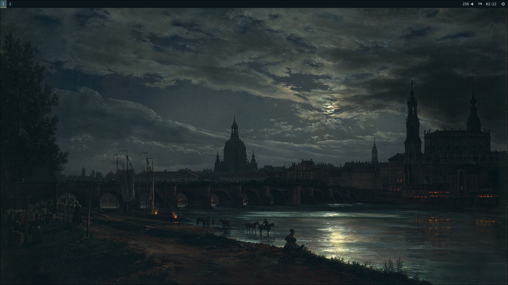
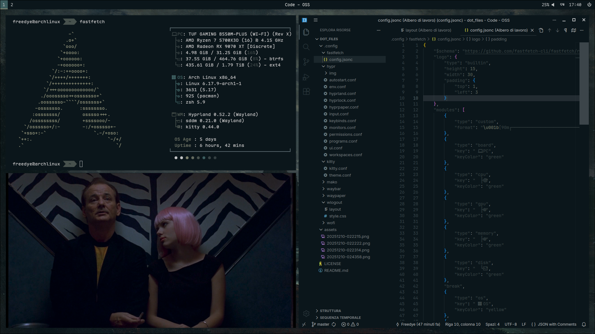
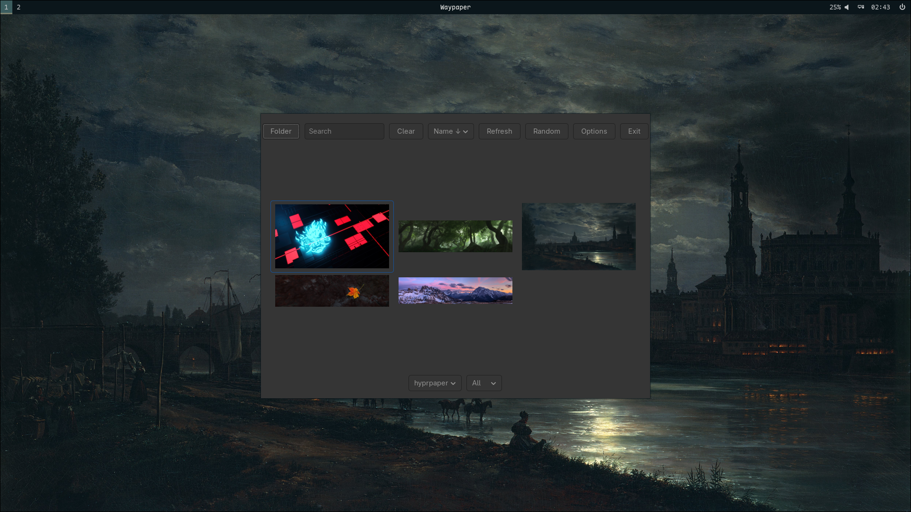
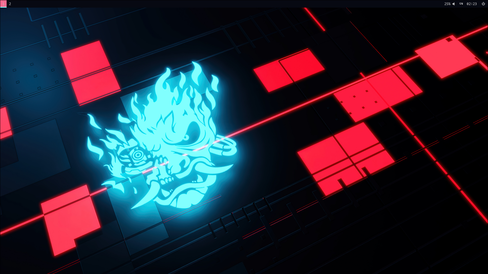

<div align="center">
    <h1>Freedye's Hyprland dotfiles</h1>
    <h3></h3>
</div>

<div align="center"> 


</div>

<div align="center">
    <h2>• Software overview •</h2>
    <h3></h3>
</div>

 <details> 
  <summary>Programs used</summary>
     
  - **Hyprland**: The compositor
  - **Hyprlock**: The screen lock
  - **Hyprpaper**: The wallpapers utility
  - **pywal16**: Automatic color scheme generation from the wallpaper
  - **fastfetch**: To fetch system infos
  - **kitty**: The terminal
  - **mako**: The notification daemon
  - **pcmanfm**: The file manager
  - **quickshell**: The upper bar, tray and power menu
  - **wofi**: The launcher
  - **grim & slurp**: The screenshoot utility
  - **wl-copy**: The clipboard utility
</details>

<div align="center">
    <h2>• screenshots •</h2>
    <h3></h3>
</div>

| Base view | Some programs |
|:---|:---------------|
|  |  |
| Wallpaper change | Automatic color switch with pywal16 |
|  |  |

<div align="center">
    <h2>• installation •</h2>
    <h3></h3>
</div>

 <details>
  <summary>Dependencies & setup</summary>

  Besides the [programs listed above](#software-overview), these dotfiles also expect:
  - **[Maple Mono](https://github.com/subframe7536/maple-font)**: font used across kitty, mako, wofi and hyprlock
  - **[rose-pine-hyprcursor](https://github.com/ndom91/rose-pine-hyprcursor)**: cursor theme
  - **wal-flat**: flat GTK theme that follows the live pywal16 palette, for GTK3 and GTK4 apps (included under `.themes/wal-flat`). libadwaita apps ignore GTK themes, so `.config/gtk-4.0/gtk.css` applies the same palette through their named colors
  - **hyprpolkitagent**: polkit authentication agent
  - **[xembedsniproxy](https://github.com/Freedye/xembedsniproxy-standalone)**: XEmbed system tray proxy (installed at `/usr/local/bin`)

  To use these configs, clone the repo and symlink (or copy) the folders/files you want into your `$HOME` and `~/.config`, e.g.:

  ```sh
  git clone https://github.com/Freedye/dotfiles-hyprland.git
  cd dotfiles-hyprland
  ln -s "$PWD/.config/hypr"       ~/.config/hypr
  ln -s "$PWD/.config/quickshell" ~/.config/quickshell
  ln -s "$PWD/.config/kitty"      ~/.config/kitty
  ln -s "$PWD/.config/mako"       ~/.config/mako
  ln -s "$PWD/.config/wofi"       ~/.config/wofi
  ln -s "$PWD/.config/fastfetch"  ~/.config/fastfetch
  ln -s "$PWD/.themes/wal-flat"   ~/.themes/wal-flat
  ln -s "$PWD/.zshrc"             ~/.zshrc
  ln -s "$PWD/.gtkrc-2.0"         ~/.gtkrc-2.0

  # single files, so the other contents of these folders are left alone
  mkdir -p ~/.config/gtk-3.0 ~/.config/gtk-4.0 ~/.config/wal/templates
  ln -s "$PWD/.config/gtk-3.0/settings.ini"        ~/.config/gtk-3.0/settings.ini
  ln -s "$PWD/.config/gtk-4.0/settings.ini"        ~/.config/gtk-4.0/settings.ini
  ln -s "$PWD/.config/gtk-4.0/gtk.css"             ~/.config/gtk-4.0/gtk.css
  ln -s "$PWD/.config/wal/templates/colors-mako"   ~/.config/wal/templates/colors-mako

  # GTK3 apps read the theme from gsettings first
  gsettings set org.gnome.desktop.interface gtk-theme wal-flat
  ```

  Then, before linking:
  - replace the `<PATH_TO_...>` placeholders (wallpaper, profile picture) in `hyprpaper.conf` and `hyprlock.conf` with your own paths;
  - replace `/home/user` with your home directory in the files that contain it (GTK CSS cannot expand `~` or `$HOME`): `grep -rl /home/user --exclude-dir=.git --exclude=README.md . | xargs sed -i "s|/home/user|$HOME|g"`.

  Hyprland and mako read the pywal16 colors when they load their config, so after changing the wallpaper run `hyprctl reload` and `makoctl reload`.
</details>

<div align="center">
    <h2>• inspirations •</h2>
    <h3></h3>
</div>

 <details> 
  <summary>Click me</summary>
     
  - **Windows**: Some keybinds are the same for an easy switch.
  - **MacOS**: I tried to make it as simple as possibile, work is still needed but it's something.
  - **[@diinki](https://github.com/diinki)**: Without their video I wouldn’t have even started.
  - **[@BreadOnPenguins](https://github.com/BreadOnPenguins)**: Her channel and her tips helped me to stay focused while I was learning new stuff.
</details>

<div align="center">
    <h2>• license •</h2>
    <h3></h3>
</div>

<div align="center">

Licensed under the [Apache License 2.0](LICENSE).

</div>